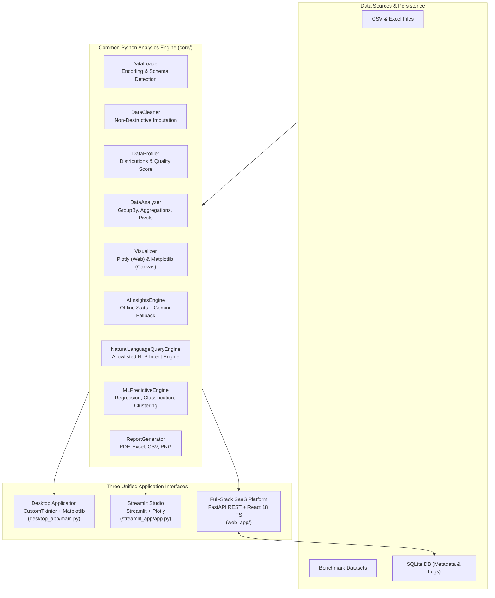

# ⚡ SmartSight AI
### *Upload. Analyze. Visualize. Predict.*

[](https://www.python.org/)
[](https://fastapi.tiangolo.com/)
[](https://react.dev/)
[](https://streamlit.io/)
[](LICENSE)
[]()

> **SmartSight AI** is a production-grade, portfolio-level Intelligent Data Analytics, Visualization & Predictive Intelligence platform. It transforms standard tabular spreadsheets (CSV and Excel) into interactive visual dashboards, autonomous statistical findings, conversational natural-language answers, and predictive machine learning forecasts.

SmartSight AI delivers **three synchronized application editions** driven by a single, shared Python analytics core engine:
1. **Desktop Suite:** Built with [CustomTkinter](https://customtkinter.tomschimansky.com/) and Matplotlib.
2. **Interactive Web App:** Built with [Streamlit](https://streamlit.io/) and Plotly.
3. **Full-Stack SaaS Platform:** Built with [React.js](https://react.dev/), [TypeScript](https://www.typescriptlang.org/), [Tailwind CSS](https://tailwindcss.com/), [FastAPI](https://fastapi.tiangolo.com/), and [SQLite](https://sqlite.org/).

---

## 📸 Key Features at a Glance

| Feature Module | Capabilities |
| :--- | :--- |
| **📁 Ingestion & Schema** | Drag-and-drop CSV & Excel loader, automated encoding fallback (`utf-8`, `latin1`, `cp1252`), delimiter sniffing, automatic type inference (continuous, discrete, datetime, text). |
| **🧹 Data Sanitization** | Non-destructive cleaning engine, duplicate purging, median/mean numeric imputation, mode/placeholder categorical imputation, IQR outlier detection, audit logging, and reset rollback. |
| **📊 Smart Profiling** | Full statistical distributions (mean, median, mode, variance, std, IQR, skewness, kurtosis), outlier frequencies, Pearson correlation matrix, and an automated 0–100 **Data Quality Index**. |
| **📈 Visual Studio** | 10+ interactive charts (Column, Bar, Line, Area, Pie, Donut, Scatter, Histogram, Box Plot, Correlation Heatmap) with dynamic aggregation and color palettes. |
| **💡 AI Insights** | Dual-mode intelligence: offline deterministic mathematical findings (group dominance, strong correlations, distribution anomalies) + optional Gemini LLM executive briefs. |
| **💬 Ask Your Data** | Safe conversational chatbot parsing natural-language questions into allowlisted pandas aggregations. Generates dynamic inline charts without arbitrary code execution. |
| **🤖 Predictive ML** | Automated task detection (Regression, Classification, Clustering), leak-free standardization, train/test evaluation (R², MAE, RMSE, Accuracy, F1, Confusion Matrix, Feature Importance). |
| **📑 Boardroom Reports** | One-click export for publication-quality ReportLab PDF executive reports, multi-sheet formatted Excel workbooks (`.xlsx`), sanitized CSVs, and PNG charts. |

---

## 🏛️ System Architecture



---

## 📂 Repository Structure

```
SmartSight-AI/
│
├── core/                              # Shared Common Python Analytics Engine
│   ├── __init__.py
│   ├── data_loader.py                 # Multi-format loader & schema inference
│   ├── data_cleaner.py                # Non-destructive data sanitization & audit
│   ├── data_profiler.py                # Statistical distributions & data quality scoring
│   ├── data_analyzer.py               # GroupBy, multi-aggregations, and safe filters
│   ├── visualization.py               # Unified Plotly & Matplotlib charting
│   ├── ai_insights.py                 # Mathematical discovery & Gemini LLM briefs
│   ├── natural_language_query.py      # Secure Ask Your Data intent engine
│   ├── ml_models.py                   # Regression, Classification & Clustering pipelines
│   └── report_generator.py            # PDF, Excel (.xlsx), CSV, and PNG exports
│
├── desktop_app/                       # Edition A: CustomTkinter Desktop Application
│   ├── main.py                        # Desktop application window & navigation
│   ├── dashboard.py                   # Reusable KPI dashboard view
│   ├── legacy_builder.py              # Preserved original Corporate Report Builder
│   └── components/
│       ├── __init__.py
│       └── stat_card.py               # Modern SaaS stat metric widget
│
├── streamlit_app/                     # Edition B: Streamlit Web Application
│   └── app.py                         # Single-command interactive web studio
│
├── web_app/                           # Edition C: Professional Full-Stack Platform
│   ├── backend/                       # High-Performance FastAPI REST Server
│   │   ├── main.py                    # Server entrypoint & static SPA mounting
│   │   ├── smartsight.db              # SQLite telemetry database
│   │   ├── database/                  # SQLite schema & database manager
│   │   ├── services/                  # In-memory dataset session manager
│   │   └── routes/                    # REST endpoints (datasets, profile, clean, etc.)
│   └── frontend/                      # React 18 + TypeScript + Tailwind CSS
│       ├── index.html
│       ├── package.json
│       ├── vite.config.ts
│       ├── tailwind.config.js
│       └── src/
│           ├── main.tsx
│           ├── App.tsx
│           ├── context/               # Global state management
│           ├── services/              # Typed REST API client
│           ├── components/            # Sidebar, Navbar, StatCard, PlotlyChart
│           └── pages/                 # 10 dedicated SaaS pages
│
├── datasets/                          # Built-in Benchmark Datasets
│   ├── corporate_employees.csv        # 250 rows (Department, Salary, Performance)
│   ├── retail_sales.csv               # 300 rows (Orders, Categories, Revenue, Profit)
│   └── customer_churn.csv             # 200 rows (Contracts, Monthly Charges, Churn)
│
├── tests/                             # Automated Unit & Integration Test Suites
│   ├── test_core.py                   # Tests all core data & ML pipelines (9/9 passing)
│   └── test_backend_api.py            # Tests all FastAPI REST endpoints (10/10 passing)
│
├── docs/                              # Technical Documentation & Diagrams
│   ├── ARCHITECTURE.md                # System design & data flow blueprint
│   └── API_DOCUMENTATION.md           # Swagger / REST endpoints specification
│
├── main.py                            # Master Unified Application Launcher
├── requirements.txt                   # Platform Python dependencies
├── .env.example                       # Environment variables template
└── README.md                          # Main project guide
```

---

## 🚀 Quickstart & Installation

### 1. Prerequisites
- **Python:** 3.10, 3.11, 3.12, or 3.14
- **Node.js:** v18+ (Required only if building/modifying the React frontend source; a pre-built production build is included!)

### 2. Clone Repository & Setup Virtual Environment
```bash
git clone https://github.com/your-username/SmartSight-AI.git
cd SmartSight-AI

# Create virtual environment (optional but recommended)
python -m venv venv
# Windows:
venv\Scripts\activate
# Linux/macOS:
source venv/bin/activate

# Install dependencies
pip install -r requirements.txt
```

### 3. Configure Environment Variables (Optional)
```bash
cp .env.example .env
```
*Note: If you have a Google Gemini API key, add `GEMINI_API_KEY=your_key` in `.env` to activate strategic narrative summaries. If omitted, SmartSight AI runs 100% offline with zero disruption.*

---

## 🖥️ How to Run Each Application

### Master Launcher
Run the interactive launcher to choose which edition to open:
```bash
python main.py
```
Or launch specific editions directly from the command line:

### 1. Desktop Application (CustomTkinter)
```bash
python main.py --mode desktop
# OR
python desktop_app/main.py
```
*Features dark/light themes, sidebar navigation, real-time Matplotlib charts, and local report exports.*

### 2. Streamlit Web Application
```bash
python main.py --mode streamlit
# OR
streamlit run streamlit_app/app.py
```
*Opens in your browser at `http://localhost:8501` with reactive Plotly charts and downloadable audit reports.*

### 3. Full-Stack Web Platform (FastAPI + React)
Start the FastAPI backend (which automatically serves the built React frontend):
```bash
python main.py --mode web
# OR
python -m uvicorn web_app.backend.main:app --host 127.0.0.1 --port 8000 --reload
```
Open **`http://localhost:8000`** in your browser.

*(Optional)* If developing the React frontend with Vite Hot-Module Reloading:
```bash
cd web_app/frontend
npm run dev
```
Open **`http://localhost:5173`** (API requests are automatically proxied to port 8000).

### 4. Legacy Corporate Report Builder
To run the original Corporate Data Analyzer tool:
```bash
python main.py --mode legacy
```

---

## 🧪 Running Automated Tests

Run the complete test suite verifying all analytics pipelines, ML estimators, and REST routes:
```bash
# Run Core Analytics Engine Tests (9 tests)
python -m unittest tests/test_core.py

# Run FastAPI REST Route Integration Tests (10 tests)
python -m unittest tests/test_backend_api.py
```

---

## 📊 Sample Datasets Provided

| Dataset File | Rows | Features | Ideal Analysis / Demonstration |
| :--- | :--- | :--- | :--- |
| `corporate_employees.csv` | 250 | Department, Education, Experience, Salary, Performance, Attrition | Salary Regression, Department GroupBy, Outlier Analysis |
| `retail_sales.csv` | 300 | Order_Date, Product, Category, Region, Unit_Price, Revenue, Profit | Sales Trend Analysis, Product Category Pie/Donut, K-Means Clustering |
| `customer_churn.csv` | 200 | Contract, Tenure, Monthly_Charges, Total_Charges, Payment_Method, Churn | Churn Classification (Logistic Regression, Random Forest, KNN) |

---

## 🛡️ Security & Integrity Guardrails

- **Zero Arbitrary Execution:** Natural-language queries in *Ask Your Data* are strictly mapped to allowlisted aggregation operators. Code generation `eval()` and `exec()` are completely disabled.
- **Leak-Free ML:** Imputation and feature scaling are fitted strictly on training splits before test scoring.
- **Non-Destructive Cleaning:** All data cleansing operations operate on an isolated copy, providing before/after previews and instant undo/reset rollback.
- **Offline First:** All statistics, charts, insights, and predictive models run locally on your CPU/GPU without external network dependencies.

---

## 📄 License
This project is licensed under the MIT License.
