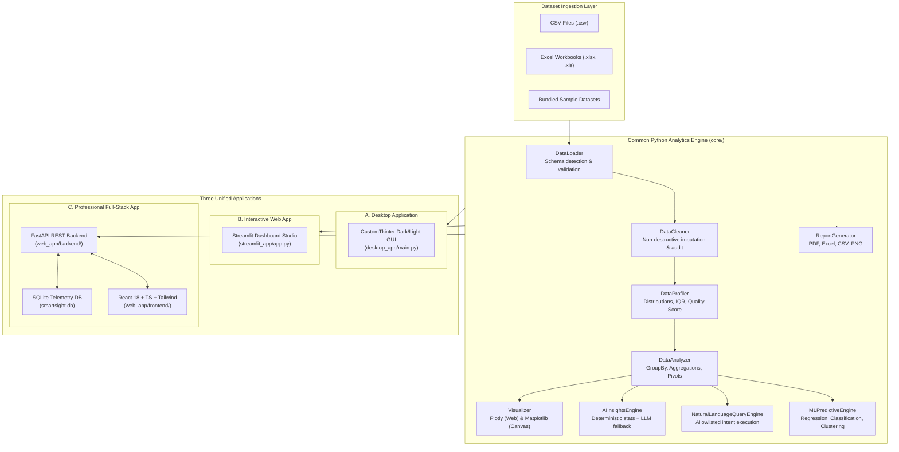

# SmartSight AI - System Architecture & Engineering Blueprint

## Platform Tagline
> **"Upload. Analyze. Visualize. Predict."**

---

## 1. High-Level Architectural Diagram

---

## 2. Core Subsystems

### A. Data Ingestion & Schema Profiling (`core/data_loader.py` & `core/data_profiler.py`)
- **Multi-encoding recovery:** Tries `utf-8`, `utf-8-sig`, `latin1`, `cp1252` with delimiter sniffer.
- **Automated Type Inference:** Accurately separates continuous numerical metrics, categorical dimensions, datetime spans, and free-form text.
- **Data Quality Index (0-100):** Weighted combination of completeness (50%), uniqueness (30%), and statistical consistency (20%).

### B. Non-Destructive Data Cleaning (`core/data_cleaner.py`)
- Leaves raw input data strictly intact.
- Imputes numerical missing values via median or mean.
- Imputes categorical missing fields via mode or custom constant.
- Outlier filtering/clipping via Interquartile Range (IQR = Q3 - Q1).
- Generates a full transformation audit trail with undo/reset capability.

### C. Unified Visualizer (`core/visualization.py`)
- **Plotly.js Interactive Pipeline:** Generates reactive JSON specifications for Streamlit and React with tooltips, pan, zoom, and responsive resizing.
- **Matplotlib Canvas Pipeline:** Generates dpi-optimized figures embedded into CustomTkinter desktop frames and vector-quality ReportLab PDF reports.

### D. Autonomous AI Insights & NL Queries (`core/ai_insights.py` & `core/natural_language_query.py`)
- **Dual-Mode Intelligence:**
  1. *Offline Deterministic Engine:* Discovers group-wise extreme averages, volume dominance (>35%), Pearson correlations (|r| >= 0.65), outlier anomalies, and heavy skewness.
  2. *LLM-Augmented Strategic Briefing:* Uses Google Gemini API to synthesize statistical facts into an executive summary when an API key is provided.
- **Security Guardrail:** *Ask Your Data* parses query intents into allowlisted aggregation functions (`mean`, `sum`, `max`, `min`, `count`). It never executes arbitrary code or shell strings.

### E. Predictive Machine Learning (`core/ml_models.py`)
- **Automated Task Detection:** Distinguishes between Regression (continuous numerical), Classification (discrete categorical), and Unsupervised Clustering.
- **Data Leakage Prevention:** Standardizes features and encodes categories fitted exclusively on training splits.
- **Benchmarked Algorithms:**
  - *Regression:* Linear Regression, Decision Tree Regressor, Random Forest Regressor.
  - *Classification:* Logistic Regression, Decision Tree Classifier, Random Forest Classifier, K-Nearest Neighbors.
  - *Clustering:* K-Means with Silhouette scoring and centroid extraction.
